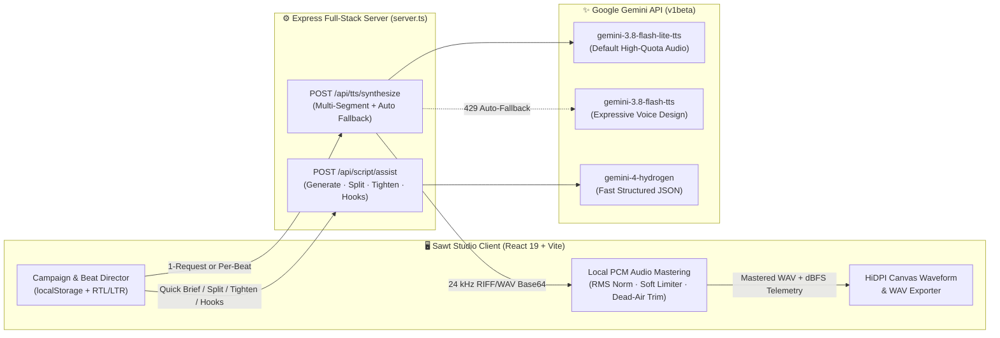

<div align="center">

# 🎙️ Sawt Studio

### High-Velocity E-Commerce Voice-Over & Dialect Mastering Studio

**Turn product briefs or raw copy into broadcast-loud, dialect-authentic ad voice-overs in seconds — engineered for media buyers, UGC teams, and MENA e-commerce brands.**

<p align="center">
  
  
  
  
  
</p>

<p align="center">
  <a href="#-why-sawt-studio">Why Sawt Studio</a> •
  <a href="#-core-capabilities">Capabilities</a> •
  <a href="#-system-architecture">Architecture</a> •
  <a href="#-voice-cast--mastering-dsp">Voices & DSP</a> •
  <a href="#-api-reference">API</a> •
  <a href="#-quick-start">Quick Start</a>
</p>

</div>

---

> [!TIP]
> **Built for speed & quota efficiency:** Sawt Studio sends all directed emotional beats in **1 single TTS request** (7× quota savings vs. per-line calls), automatically falls back from `gemini-3.8-flash-tts` to `gemini-3.8-flash-lite-tts` on daily free-tier limits, and runs **real-time PCM loudness mastering locally in the browser** with zero extra API calls.

---

## 🚀 Why Sawt Studio?

Performance marketers launch dozens of creative variations every week and cannot waste hours manually splitting scripts, fixing stiff Modern Standard Arabic (Fusha) pronunciation, or leveling quiet voice-overs in external DAWs.

**Sawt Studio** streamlines the entire ad audio pipeline into one focused browser console:

1. 📝 **Brief or Paste** — Generate a beat-directed ad from a product brief, paste raw WhatsApp/Notion copy, or start from a proven template.
2. 🎯 **Direct & Optimize** — Tighten scripts to `< 2:00`, `60s`, or `30s` targets, generate 3 scroll-stopping Hook A/B variants, and fine-tune dialect phonetics.
3. 🔊 **Synthesize & Master** — Render 24 kHz 16-bit WAV audio with male/female voices, instant **Social Feed Loud** normalization, soft-knee `-1.0 dBFS` limiting, and **0.0s dead-air hook trimming** — ready to drop straight into CapCut or Premiere.

---

## ✨ Core Capabilities

| Area | What It Does |
| :--- | :--- |
| 🎬 **Multi-Format Ad Presets** | 1-click switching across **Mini-VSL (`< 2:00`)**, **TikTok / Reels UGC (`30–40s`)**, **Direct Response PAS (`60s`)**, **Flash Sale (`15–20s`)**, and **Customer Story (`45s`)** with live runtime estimation vs. format targets. |
| 🌍 **8 Dialects & Languages** | Native phonetic direction for **Tunisian Derja** (default), **Moroccan Darija**, **Algerian Darja**, **Gulf / Khaleeji**, **Levantine**, **Egyptian**, **French**, and **English**, with automatic `RTL` / `LTR` script editors. |
| 🗣️ **Male & Female Voice Cast** | Gender-filtered casting across all 5 Gemini 3.8 voices (**Kore**, **Zephyr**, **Puck**, **Charon**, **Fenrir**) paired with 5 vocal ad styles and 4 **Speaking Pace** targets (`Relaxed`, `Natural`, `Brisk`, `Fast Reel`). |
| ⚡ **Zero-Scratch E-Com Tools** | **Quick Brief Builder**, **Paste & Auto-Split**, **1-Click Tighten to Target**, and **3 Hook A/B Ideas** powered server-side by `gemini-4-hydrogen` structured JSON output. |
| 🎚️ **Instant Local Audio Mastering** | Client-side 16-bit PCM DSP engine with **Social Feed Loud**, **Broadcast Warm**, **Raw Studio**, `-6 dB` to `+12 dB` gain slider, analog-style soft-knee peak limiting (`-1.0 dBFS`), and **0.0s dead-air hook trimming**. |
| 📊 **HiDPI Waveform & Takes Archive** | Interactive `<canvas>` waveform with beat markers, click-to-scrub playhead, live RMS/Peak dBFS readouts, `0.9x–1.2x` preview speed, session take A/B comparison, and local campaign persistence (`localStorage`). |

---

## 🏗️ System Architecture



---

## 🎛️ Voice Cast & Mastering DSP

<details open>
<summary><strong>🎙️ Voice Cast Matrix (Male & Female)</strong></summary>

<br />

| Voice | Gender | Vocal Character | Best E-Commerce Use Cases |
| :--- | :--- | :--- | :--- |
| **Kore** *(Default)* | Female | Warm, grounded & trustworthy | Wellness, skincare, late-30s Mini-VSL storytelling |
| **Zephyr** | Female | Bright, airy & friendly | 20s–30s TikTok UGC, beauty demos, lifestyle hooks |
| **Puck** | Male | Lively, sharp & energetic | Fast Reels, gadget demos, direct-response offers |
| **Charon** | Male | Calm, credible & measured | Founder stories, expert explainers, clinical trust |
| **Fenrir** | Male | Deep, bold & commanding | Flash sales, luxury fragrances, automotive promos |

</details>

<details>
<summary><strong>🔊 Client-Side PCM Mastering Pipeline (Zero Extra API Calls)</strong></summary>

<br />

Every mastering tweak (`Social Loud`, `Broadcast`, `Output Gain`, `Trim Dead Air`) re-processes the raw 24 kHz 16-bit PCM WAV buffer locally in `< 20ms`:

1. **Dead-Air Hook Trimming (`0.0s Hook`)** — Scans leading/trailing silence below `-40 dBFS` and trims with a smooth `15ms` micro fade-in/out cushion so video hooks hit immediately without clicks.
2. **Active-Speech RMS Normalization** — Measures RMS strictly on active vocal frames (ignoring dramatic pauses) to target punchy **Social Feed Loud** (`-14 LUFS` feel) or balanced **Broadcast Warm** (`-16 LUFS` feel).
3. **Soft-Knee Peak Limiter (`-1.0 dBFS` Ceiling)** — Applies smooth `tanh` saturation above `-2.4 dBFS`, mathematically guaranteeing zero digital clipping even at `+12 dB` boost.
4. **Live dBFS Metering** — Outputs real measured `RMS dBFS` and `Peak dBFS` values directly below the waveform.

</details>

<details>
<summary><strong>🇹🇳 Built-In Tunisian Derja Phonetic Engine</strong></summary>

<br />

Sawt Studio ships with a searchable 22-term pronunciation reference and pre-loaded **Fenoa Légèreté Plus 7-Beat Mini-VSL** template calibrated for authentic Tunis/coastal Derja:

| Script Term | Phonetic Guide | Why It Matters |
| :--- | :--- | :--- |
| `الڨنّارية` | `el-guenariya` | Forces hard **G** (`ڨ`) while preserving coastal Tunis **Qaf** on `فوق`, `تفيق`, `تقوم`, `قعدة` |
| `المَيْدَة` | `el-meyda` | Prevents TTS from slipping into classical Fusha `el-ma’ida` |
| `يِتْسَلَّعْلِكْ` | `yitsalla‘lik` | Full harakat ensure smooth delivery of this purely Tunisian verb |
| `إِخْلِصْ` | `ikhlis` | Enforces Tunisian imperative ("pay") instead of `akhlas` |
| `دْرِيناجْ` / `پُوندُونْ` / `فْلاكُونْ` | `drénage` / `pendant` / `flacon` | Natural `پ` & diacritic spellings blend embedded French loanwords effortlessly |

</details>

---

## 🔌 API Reference

<details>
<summary><strong>Server Endpoints (<code>server.ts</code>)</strong></summary>

<br />

### `POST /api/tts/synthesize`
Synthesizes single or multi-segment directed speech via Gemini 3.8 TTS (`v1beta`) with automatic quota fallback to `gemini-3.8-flash-lite-tts`.

```json
{
  "segments": [
    {
      "text": "كان مرا فوق الخمسة وتلاثين… شنوّة تنجّم تلاحظ في بدنها؟",
      "style": "Warm Tunisian woman in her late 30s, curious scroll-stopping hook."
    }
  ],
  "voiceName": "Kore",
  "model": "gemini-3.8-flash-lite-tts"
}
```

### `POST /api/script/assist`
Powers e-commerce script automation via `gemini-4-hydrogen` with structured JSON schemas.

| `mode` | Purpose |
| :--- | :--- |
| `"generate"` | Creates a full beat-directed ad script from a product brief & target runtime |
| `"split"` | Structures raw pasted copy into directed beats with dialect phonetic polish |
| `"tighten"` | Trims copy and excess ellipses to hit your format’s target duration |
| `"hooks"` | Generates 3 scroll-stopping opening hook variations for Meta/TikTok A/B tests |

### `GET /api/health`
Returns `{ "ok": true }` for uptime checks.

</details>

---

## 📂 Project Structure

<details>
<summary><strong>View File Tree</strong></summary>

```text
sawt-studio/
├── server.ts                              # Express + Vite server, Gemini 3.8 TTS & 4-Hydrogen routes
├── index.html                             # Entry HTML, Google Fonts (Plus Jakarta Sans, IBM Plex Arabic/Mono)
├── src/
│   ├── App.tsx                            # Main studio state, localStorage campaigns, DSP mastering & workflows
│   ├── index.css                          # Tailwind CSS v4 tokens & studio slider styles
│   ├── data/
│   │   └── scriptData.ts                  # Formats, styles, 8 dialects, 5 voices, paces, templates & glossary
│   ├── utils/
│   │   └── wavUtils.ts                    # RIFF/WAV parser, stitcher, RMS/limiter DSP & waveform peak extractor
│   └── components/
│       ├── WaveformPlayer.tsx             # HiDPI interactive canvas waveform, transport & dBFS readouts
│       ├── SidebarControls.tsx            # Campaign switcher, voice/gender cast, pace & volume mastering rail
│       ├── BeatEditorRow.tsx              # RTL/LTR beat editor, vocal cues, pause slider & single-beat retake
│       ├── QuickBriefGenerator.tsx        # Zero-to-ad product brief form with 1-click e-com sample briefs
│       ├── TakesArchive.tsx               # Session takes history for A/B playback and WAV export
│       └── PronunciationReference.tsx     # Searchable Tunisian Phonetics & French Loanwords guide
├── .env.example                           # Environment variable template
├── package.json                           # Scripts & dependencies
└── vite.config.ts                         # Vite + Tailwind v4 configuration
```

</details>

---

## ⚡ Quick Start

### 1. Prerequisites
- **Node.js 22+** (supports running `server.ts` directly in production)
- A **Gemini API Key** from [Google AI Studio](https://aistudio.google.com/)

### 2. Configure Environment
Copy `.env.example` to `.env` and add your Gemini API key:

```bash
cp .env.example .env
```

```env
GEMINI_API_KEY="your_gemini_api_key_here"
PORT=3000
```

> [!NOTE]
> `GEMINI_API_KEY` is used exclusively on the Express backend (`server.ts`) and is never exposed to the browser bundle.

### 3. Install & Run Locally

```bash
# Install dependencies
npm install

# Start full-stack dev server (Express + Vite middleware on http://localhost:3000)
npm run dev
```

### 4. Available Scripts

| Command | Description |
| :--- | :--- |
| `npm run dev` | Starts the Express + Vite development server on port `3000` via `tsx server.ts` |
| `npm run build` | Builds the optimized production frontend bundle into `dist/` |
| `npm start` | Runs the production server (`node server.ts`) serving `dist/` and `/api/*` |
| `npm run lint` | Runs strict TypeScript typechecking (`tsc --noEmit`) |

---

<div align="center">
  <sub>Built for fast e-commerce creative testing · 24 kHz 16-bit PCM WAV Export</sub>
</div>
